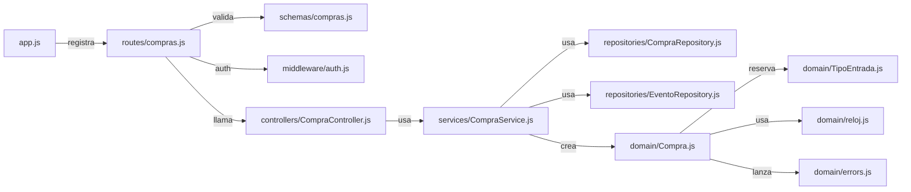

# Spec 03a: Compras (dominio completo, crear, pagar y listar)

## Requirements

### Overview & Goals

Implementar todo el dominio de `Compra` (5 estados, máquina de transiciones, historial, SISTEMA, reembolso automático) y exponer por API solo los endpoints de crear, pagar y listar. Las transiciones de uso y cancelación quedan probadas en el dominio pero se exponen por API en el spec 03b.

### Scope

**In Scope:**
- `diasCalendario(desde, hasta)` en `src/domain/reloj.js`: días de calendario en zona `America/Argentina/Buenos_Aires` con `Intl.DateTimeFormat`.
- `EstadoCompra`: enum con `PENDIENTE`, `CONFIRMADA`, `UTILIZADA`, `CANCELADA`, `REEMBOLSADA`.
- `SISTEMA`: constante `{ id: "sistema", nombre: "Sistema" }` para el reembolso automático.
- `CambioEstadoCompra`: factory que crea `{ compra, estado, quien, fechaHora }`.
- `Compra`: entidad con `crear()`, `actualizarEstado()`, `diasParaEvento()`, `paraRespuesta()`.
- Tabla de transiciones en `Compra` (no if/else): PENDIENTE→CONFIRMADA, CONFIRMADA→UTILIZADA, PENDIENTE→CANCELADA, CONFIRMADA→CANCELADA→REEMBOLSADA.
- `CompraRepository`: interfaz + memoria con `guardar`, `buscarPorId`, `listarPorComprador`. IDs por contador (`cp_1`, ...).
- Seed de compras determinístico con los 5 estados, usando `fijarAhora()` para el evento pasado.
- Schemas de zod: `crearCompraBodySchema`, `compraIdParamsSchema`, `emptyQuerySchema`.
- `CompraService`: `crear`, `pagar`, `misCompras`.
- `CompraController`: clase con handlers `crear`, `pagar`, `misCompras`.
- Rutas: `POST /compras`, `POST /compras/:id/pago`, `GET /compras`.
- Cableado en `app.js`, `server.js`, `crearApp.js`.
- Tests de dominio: `reloj.test.js` (diasCalendario), `Compra.test.js` (25 transiciones, actores, cupo, historial).
- Tests de API: `compras.test.js` (crear, pagar, listar, validación, permisos, cupo).
- Actualizar `docs/architecture.md`.

**Out of Scope:**
- Endpoints de uso (`/uso`) y cancelación (`/cancelación`) — spec 03b.
- Vista de compras del organizador — spec 03c.
- Mensajes de chat — spec 04.
- Reseñas — spec 05.

### Acceptance Criteria

- `npm test` completo pasa y se muestra la salida.
- La tabla de transiciones se prueba con las 25 combinaciones (5x5).
- Toda regla de estados y cupo está en `Compra`/`TipoEntrada`; el service y los controllers no tienen `if` sobre estados.
- Un cambio fallido no deja cambios parciales (verificado en tests).
- Ningún `new Date(` ni `Date.now(` fuera de `reloj.js`.
- El seed contiene compras en los 5 estados y el cupo es coherente con ellas.
- Params, query y body validados con schemas de zod; controllers leen solo de `req.validado`.
- Zod no se importa fuera de `src/schemas/` y `src/middleware/validar.js`.
- `package.json` sigue teniendo solo `express` y `zod`.
- `docs/architecture.md` actualizado.

## Technical Design

### Current Implementation

El backend tiene: autenticación (AuthService, AuthController, SesionService), validación con zod (middleware `validar`, schemas), errores de dominio unificados, `Usuario` con hash, `Evento` con `TipoEntrada` (cupo, reservar, liberar), repositorios en memoria con IDs por contador, seed de usuarios/categorías/eventos, `reloj.js` centralizado con `ahora()`, `fijarAhora()`, `restaurarReloj()`, `parsearFecha()` y `sumarDias()`. Todo cableado como clases con inyección por constructor.

### Key Decisions

- **Tabla de transiciones en `Compra`:** En lugar de if/else, una tabla de objetos `{ puede, condicion, efecto }` indexada por estado origen y destino. Esto hace la máquina de estados explícita, fácil de probar y extender.
- **Historial con referencia al objeto Compra:** El `CambioEstadoCompra` almacena una referencia al objeto `Compra` (no el id string). Al serializar, se accede a `entry.compra.id`. Esto evita tener que conocer el id antes de que el repositorio lo genere.
- **Seed con `fijarAhora()` para eventos pasados:** Para crear la compra UTILIZADA del evento pasado, se fija el reloj a un día antes del evento, se crea y transiciona la compra, y se restaura el reloj en `finally`.
- **`diasCalendario` con `Intl.DateTimeFormat`:** Extrae año, mes, día en la zona Argentina, construye fechas UTC desde esos componentes y calcula la diferencia en días. Sin dependencias.
- **`actualizarEstado` valida antes de mutar:** Primero se valida que la transición exista (ConflictError), luego el actor (ForbiddenError), luego las condiciones (ConflictError). Solo después se aplican efectos y se registra en el historial. Si algo falla, no queda rastro.
- **CONFIRMADA → CANCELADA → REEMBOLSADA automático:** Después de aplicar la transición CANCELADA, si el estado anterior era CONFIRMADA, se aplica automáticamente REEMBOLSADA con `SISTEMA` como actor. No se llama recursivamente a `actualizarEstado`.

### Proposed Changes

**1. `src/domain/reloj.js` (modificado)**

Agregar `diasCalendario(desde, hasta)`:
- Usa `Intl.DateTimeFormat` con `timeZone: 'America/Argentina/Buenos_Aires'` para extraer año, mes, día de ambas fechas.
- Construye fechas UTC desde esos componentes.
- Devuelve la diferencia en días (redondeada).
- Exportar también `diasCalendario`.

**2. `src/domain/Compra.js` (nuevo)**

Exporta: `EstadoCompra` (enum), `SISTEMA` (constante), `crearCambioEstadoCompra` (factory), `Compra` (clase).

`EstadoCompra`: `{ PENDIENTE, CONFIRMADA, UTILIZADA, CANCELADA, REEMBOLSADA }`.

`SISTEMA`: `{ id: 'sistema', nombre: 'Sistema' }`.

`crearCambioEstadoCompra({ compra, estado, quien })`: devuelve `{ compra, estado, quien, fechaHora: ahora() }`.

`Compra`:
- Propiedades: id, comprador, evento, tipoEntrada, cantidad, total, estado, historial.
- `crear({ id, comprador, evento, tipoEntrada, cantidad })`:
  - Valida cantidad entero >= 1 (ValidationError).
  - Valida tipoEntrada pertenece a evento (ValidationError).
  - Valida comprador ≠ organizador (ForbiddenError).
  - Valida evento no ya realizado (ConflictError).
  - Valida cupo disponible (ConflictError).
  - Reserva cupo (`tipoEntrada.reservar(cantidad)`).
  - Calcula `total = precio × cantidad`.
  - Nace PENDIENTE, registra primer CambioEstadoCompra (quién = comprador).
  - Es atómico: si algo falla, ni el cupo ni nada más cambia.
- `actualizarEstado(nuevoEstado, usuario)`:
  - Busca la transición en la tabla.
  - Valida existencia (ConflictError), actor (ForbiddenError), condiciones (ConflictError).
  - Aplica efectos (ej. `liberar(cantidad)`).
  - Registra en historial.
  - Si fue CONFIRMADA → CANCELADA, aplica REEMBOLSADA automático con SISTEMA.
- `diasParaEvento()`: si CONFIRMADA, `Math.max(0, diasCalendario(ahora(), evento.fecha))`; sino `null`.
- `paraRespuesta()`: formato de respuesta API (sin email, contraseña ni hash).

Tabla de transiciones (internamente en `Compra.js`):
```
PENDIENTE → CONFIRMADA: puede=comprador
PENDIENTE → CANCELADA: puede=comprador, condicion=evento no realizado, efecto=liberar cupo
CONFIRMADA → UTILIZADA: puede=organizador del evento
CONFIRMADA → CANCELADA: puede=comprador, condicion=evento no realizado, efecto=liberar cupo
(los estados UTILIZADA, CANCELADA, REEMBOLSADA no tienen salidas)
```

**3. `src/repositories/CompraRepository.js` (nuevo)**

Clase con `guardar` (genera ID `cp_N` si no tiene), `buscarPorId`, `listarPorComprador(compradorId)`.

**4. `src/seed/compras.js` (nuevo)**

Seed determinístico con compras de `comprador1` en los 5 estados:
- PENDIENTE: evt_recital1, General, cantidad 1.
- CONFIRMADA: evt_teatro1, General, cantidad 2.
- UTILIZADA: evt_pasado1, General, cantidad 1 (con `fijarAhora` un día antes del evento, `restaurarReloj` en `finally`).
- CANCELADA (desde PENDIENTE): evt_festival1, Entrada, cantidad 1.
- REEMBOLSADA (desde CONFIRMADA): evt_conferencia1, Online, cantidad 1.

El cupo queda consistente: las compras CANCELADA y REEMBOLSADA liberan el cupo que reservaron.

**5. `src/schemas/compras.js` (nuevo)**

- `crearCompraBodySchema`: `z.strictObject({ eventoId: idSchema, tipoEntradaId: idSchema, cantidad: z.number() })`. Sin coerción.
- `compraIdParamsSchema`: `z.strictObject({ id: idSchema })`.
- `emptyQuerySchema`: `z.strictObject({})` — rechaza cualquier parámetro.

**6. `src/services/CompraService.js` (nuevo)**

Clase, constructor `{ compraRepository, eventoRepository }`.
- `crear({ eventoId, tipoEntradaId, cantidad }, comprador)`: busca evento y tipoEntrada, llama a `Compra.crear`, guarda en repositorio.
- `pagar(id, comprador)`: busca compra, llama a `compra.actualizarEstado(CONFIRMADA, comprador)`.
- `misCompras(comprador)`: lista por comprador, ordena por `historial[0].fechaHora` descendente.

**7. `src/controllers/CompraController.js` (nuevo)**

Clase, constructor `{ compraService }`. Handlers como arrow functions class fields:
- `crear`: lee `req.validado.body`, pasa `req.usuario`, responde 201 con `compra.paraRespuesta()`.
- `pagar`: lee `req.validado.params.id`, pasa `req.usuario`, responde 200.
- `misCompras`: pasa `req.usuario`, responde con array de `paraRespuesta()`.

Sin try/catch ni reglas de negocio.

**8. `src/routes/compras.js` (nuevo)**

`crearRutasCompra({ compraController, authMiddleware })`:
- `POST /`: auth, `validar({ body: crearCompraBodySchema })`, `asyncHandler(crear)`.
- `POST /:id/pago`: auth, `validar({ params: compraIdParamsSchema })`, `asyncHandler(pagar)`.
- `GET /`: auth, `validar({ query: emptyQuerySchema })`, `asyncHandler(misCompras)`.

**9. Cableado**

- `src/app.js`: agregar `crearRutasCompra` con auth y controller.
- `src/server.js`: instanciar CompraRepository, CompraService, CompraController. Llamar al seed de compras.
- `test/helpers/crearApp.js`: instanciar los nuevos componentes. Llamar al seed de compras.

**10. `docs/architecture.md` (modificado)**

Agregar: `Compra.crear`, `SISTEMA`, `historial` embebido en `Compra`, `diasParaEvento()`, `diasCalendario` en `reloj.js`, mapeo de transición inválida a `ConflictError` (409), nuevos endpoints.

### Architecture Diagram



### Risks

- **`Intl.DateTimeFormat` y zonas horarias:** Es una API estándar de JavaScript, disponible en Node.js. No hay riesgo de compatibilidad.
- **Atomicidad de `Compra.crear`:** Todas las validaciones ocurren antes de `tipoEntrada.reservar()`. En un entorno single-thread (Node.js), esto garantiza atomicidad.
- **`actualizarEstado` sin rastros parciales:** Las validaciones ocurren antes de cualquier mutación. Si una falla, el estado, cupo e historial no cambian.
- **Seed con `fijarAhora()`:** El seed debe siempre llamar a `restaurarReloj()` en un bloque `finally`. Si se olvida, los tests siguientes tendrán el reloj fijado.
- **`evento.tiposEntrada.includes(tipoEntrada)`:** Compara referencias de objeto. El service pasa el objeto real del array, por lo que funciona.

## Testing

### Validation Approach

Ejecutar `npm test` completo después de cada stage. Los tests de dominio validan reglas de negocio directamente; los tests de API validan endpoints con `fetch` y puerto efímero.

### Key Scenarios

**Dominio — `reloj.test.js`:**
- `diasCalendario`: mismo día = 0, mañana a la noche = 1, cruce de medianoche en hora argentina, varios días.

**Dominio — `Compra.test.js`:**
- `crear`: nace PENDIENTE, total correcto, cupo reservado, historial con una entrada.
- `crear` falla (sin cambiar cupo): cantidad 0, negativa, 1.5, texto, NaN; tipo de otro evento; comprador = organizador; evento ya realizado; cantidad > cupo.
- Comprar exactamente el cupo funciona; la siguiente de 1 falla.
- **Tabla exhaustiva de transiciones:** 5x5 = 25 combinaciones, generadas con un arreglo de casos. Solo 4 son válidas (con actor correcto); las 21 lanzan `ConflictError`.
- Actor incorrecto para cada transición válida: pagar un tercero, pagar el organizador, usar el comprador, usar otro organizador, cancelar el organizador, cancelar un tercero: todos `ForbiddenError`.
- Cancelar desde PENDIENTE: CANCELADA, cupo devuelto, historial de 2 entradas, sin REEMBOLSADA.
- Cancelar desde CONFIRMADA: REEMBOLSADA, cupo devuelto, historial con CANCELADA (quién = comprador) y REEMBOLSADA (quién = SISTEMA).
- Cancelar UTILIZADA: falla.
- Cancelar evento ya realizado: falla (fijar reloj después de la fecha del evento).
- Transición fallida no cambia estado, cupo ni historial.
- `diasParaEvento`: número solo si CONFIRMADA, `null` en otros estados, 0 mismo día, nunca negativo.

**API — `compras.test.js`:**
- Crear: 201, forma de respuesta, `GET /eventos/:id` muestra cupoDisponible reducido.
- Cada causa de 400: campo faltante, cantidad como texto ("2"), eventoId numérico, claves extra, campos faltantes.
- `:id` inválido en `/pago`, parámetro de query en `GET /compras` o `/pago`: 400.
- Organizador comprando su evento: 403.
- Evento ya realizado: 409.
- Cantidad > cupo: 409, cupo no cambia.
- Dos compras que superan cupo: primera 201, segunda 409.
- Pagar: 200, CONFIRMADA; pagar de nuevo: 409; pagar ajena: 403; pagar inexistente: 404.
- `GET /compras`: solo las del usuario, con las del seed, `diasParaEvento` solo en CONFIRMADA.
- Sin datos sensibles en respuestas.
- Sin token: 401.

### Edge Cases

- `cantidad` como texto ("2"): 400 por zod (sin coerción).
- `cantidad` como float (1.5): 400 por zod (z.number() acepta floats, pero `Compra.crear` valida entero).
- Body con claves extra: 400 por `.strict()`.
- `GET /compras?q=algo`: 400 por `emptyQuerySchema`.
- `POST /compras/:id/pago` con body: se ignora.
- `POST /compras/:id/pago` con `:id` inválido: 400.
- Comprar exactamente el cupo disponible: funciona. La siguiente compra de 1 falla con 409.
- `diasParaEvento` el mismo día del evento: 0, no negativo.

## Execution Plan

### ✓ Step 1: diasCalendario en reloj.js y test
Agregar `diasCalendario(desde, hasta)` a `src/domain/reloj.js` y crear `test/domain/reloj.test.js`.

### ✓ Step 2: Compra.js con máquina de estados y tests de dominio
Crear `src/domain/Compra.js` con `EstadoCompra`, `SISTEMA`, `crearCambioEstadoCompra`, `Compra` (crear, actualizarEstado, diasParaEvento, paraRespuesta) y tabla de transiciones. Crear `test/domain/Compra.test.js` con 25 transiciones, actores, cupo e historial.

### ✓ Step 3: CompraRepository, seed de compras y schemas
Crear `src/repositories/CompraRepository.js`, `src/seed/compras.js` y `src/schemas/compras.js`.

### ✓ Step 4: CompraService, CompraController y rutas
Crear `src/services/CompraService.js`, `src/controllers/CompraController.js` y `src/routes/compras.js`.

### ✓ Step 5: Cableado en app.js, server.js, crearApp.js
Actualizar `src/app.js`, `src/server.js` y `test/helpers/crearApp.js` con los nuevos componentes.

### ✓ Step 6: Tests de API y actualización de docs
Crear `test/api/compras.test.js` y actualizar `docs/architecture.md`. Ejecutar `npm test` completo.

# Resultados

- `npm test`: **160 tests pasados, 0 fallados** (33 auth + 5 errores + 23 eventos API + 5 validar + 14 Usuario + 18 TipoEntrada + 14 Evento + 5 reloj + 36 Compra + 23 compras API).
- `new Date()` solo en `reloj.js`. `Date.now()` no usado en ningún archivo.
- Zod importado solo en `src/schemas/` y `src/middleware/validar.js`.
- Sin `try/catch` en controllers.
- Sin datos sensibles (email, contraseña, hash) en respuestas.
- Tabla de transiciones probada con 25 combinaciones (5×5).
- Seed con compras en los 5 estados y cupo coherente.
- `docs/architecture.md` ya documentaba todos los conceptos de Compra — no requirió cambios.
