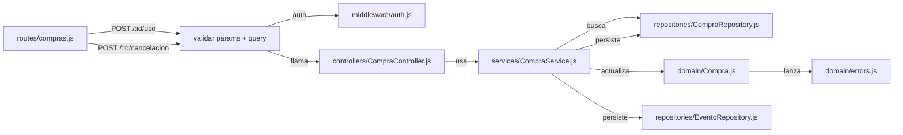

# Spec 03b: Compras — Uso y Cancelación por API

## Requirements

### Overview & Goals

Exponer por API las transiciones de uso y cancelación de compras. El dominio de `Compra` (tabla de transiciones, cupo, historial, reembolso automático) ya está implementado y probado en el spec 03a. Este spec solo agrega dos endpoints y sus tests.

### Scope

**In Scope:**
- `POST /compras/:id/uso`: CONFIRMADA → UTILIZADA. Solo el organizador del evento. Auth obligatorio.
- `POST /compras/:id/cancelacion`: cancela la compra. Solo el comprador. Auth obligatorio. Reembolso automático si venía de CONFIRMADA.
- Validación de `:id` con `compraIdParamsSchema` (reutilizado del spec 03a).
- Rechazo de query params con `emptyQuerySchema` (reutilizado).
- `CompraService`: métodos `usar()` y `cancelar()` que delegan en el dominio.
- `CompraController`: handlers `usar` y `cancelar`.
- Tests de API: uso, cancelación, permisos, estados inválidos, schemas, casos borde.

**Out of Scope:**
- Reglas nuevas de dominio — el dominio no cambia.
- Vista de compras del organizador (spec 03c).
- Chat (spec 04) y reseñas (spec 05).
- Nuevos schemas de zod.

### Acceptance Criteria

- `npm test` completo pasa.
- Los 6 casos borde de `business-context.md` sección 9 sobre uso y cancelación tienen test.
- Ni el service ni los controllers tienen `if` sobre estados o permisos.
- El dominio no importa zod ni Express.
- Los parámetros de ruta pasan por schema de zod; controllers leen de `req.validado.params`.
- Ningún `new Date(` ni `Date.now(` fuera de `reloj.js`.
- Los tests que cambian el reloj lo restauran siempre.
- `package.json` tiene solo `express` y `zod`.

## Technical Design

### Current Implementation

- `CompraService.js`: tiene `crear()`, `pagar()` y `misCompras()`. `pagar()` llama a `compra.actualizarEstado(CONFIRMADA, comprador)` sin persistir después.
- `CompraController.js`: handlers `crear`, `pagar`, `misCompras` como arrow functions.
- `routes/compras.js`: 3 rutas (`POST /`, `POST /:id/pago`, `GET /`), todas con auth y validación.
- `schemas/compras.js`: ya tiene `compraIdParamsSchema` y `emptyQuerySchema`.
- `Compra.js`: dominio completo con tabla de transiciones, `actualizarEstado()`, reembolso automático, historial.
- `compras.test.js`: tests de crear, pagar y listar (spec 03a).

### Key Decisions

- **Reutilizar schemas existentes:** `compraIdParamsSchema` y `emptyQuerySchema` ya están en `schemas/compras.js`. No se crean schemas nuevos.
- **Validar params y query juntos:** `validar({ params: compraIdParamsSchema, query: emptyQuerySchema })` en ambas rutas.
- **Persistir después de `actualizarEstado`:** `compraRepository.guardar()` y `eventoRepository.guardar()` después de cambiar estado, para asegurar consistencia si se reemplaza el repositorio.
- **El service no tiene `if` sobre estados:** `usar()` y `cancelar()` solo buscan la compra y delegan en `compra.actualizarEstado()`.

### Proposed Changes

**1. `src/services/CompraService.js` (modificado)**
- Agregar `usar(compraId, usuario)`: busca compra, llama `actualizarEstado(UTILIZADA, usuario)`, persiste compra y evento.
- Agregar `cancelar(compraId, usuario)`: busca compra, llama `actualizarEstado(CANCELADA, usuario)`, persiste compra y evento.
- Corregir `pagar()` para persistir después de `actualizarEstado()`.

**2. `src/controllers/CompraController.js` (modificado)**
- Agregar `usar = (req, res) => {}`: lee `req.validado.params.id`, llama al service, responde JSON.
- Agregar `cancelar = (req, res) => {}`: lee `req.validado.params.id`, llama al service, responde JSON.

**3. `src/routes/compras.js` (modificado)**
- Agregar `POST /:id/uso` con auth, validación y asyncHandler.
- Agregar `POST /:id/cancelacion` con auth, validación y asyncHandler.

**4. `test/api/compras.test.js` (ampliado)**
- ~27 tests nuevos: uso (flujo, permisos, estados inválidos, borde), cancelación (PENDIENTE, CONFIRMADA, UTILIZADA, evento realizado, dos veces, permisos, borde), flujo completo y cupo tras cancelación.

### Architecture Diagram

### Risks

- **`validar({ params, query })` con ambos:** El middleware ya soporta validar params y query simultáneamente.
- **Persistir evento después de `actualizarEstado`:** `eventoRepository.guardar()` actualiza la referencia en el Map.
- **`fijarAhora()` en tests:** Los tests que avanzan el reloj llaman a `restaurarReloj()` en `afterEach`.

## Testing

### Validation Approach

Ampliar `test/api/compras.test.js` con los nuevos casos. Ejecutar `npm test` completo al final.

### Key Scenarios

**Uso:**
- Flujo: crear → pagar → organizador marca UTILIZADA: 200, estado UTILIZADA, historial con 3 entradas.
- Comprador intenta UTILIZADA: 403. Otro organizador: 403.
- Estados inválidos: PENDIENTE (409), dos veces (409), CANCELADA (409), REEMBOLSADA (409).
- Inexistente: 404. Sin token: 401. `:id` inválido: 400. Query `?x=1`: 400.

**Cancelación:**
- PENDIENTE: 200, CANCELADA, cupo devuelto, sin REEMBOLSADA.
- CONFIRMADA: 200, REEMBOLSADA, cupo devuelto, historial correcto.
- UTILIZADA: 409. Evento realizado: 409. Dos veces: 409.
- Organizador: 403. Tercero: 403. Inexistente: 404. Sin token: 401.

**Flujos completos:**
- Crear → pagar → cancelar → REEMBOLSADA, verificar estado y cupo.
- Dos compras agotan cupo, se cancela una, tercera compra funciona.

## Execution Plan

### ✓ Step 1: Agregar usar() y cancelar() al service, controller y rutas

Se exponen dos nuevos endpoints: `POST /compras/:id/uso` y `POST /compras/:id/cancelacion`.

- `src/services/CompraService.js`: agregados `usar()` y `cancelar()`. Corregido `pagar()` para persistir.
- `src/controllers/CompraController.js`: agregados handlers `usar` y `cancelar`.
- `src/routes/compras.js`: agregadas las dos rutas con auth y validación.
- Los 160 tests existentes siguen pasando.

### ✓ Step 2: Tests de API: uso, cancelación, schemas y casos borde

Se amplía `test/api/compras.test.js` con 27 nuevos tests.

- **Uso**: flujo completo, permisos, estados inválidos, borde (404, 401, 400).
- **Cancelación**: PENDIENTE, CONFIRMADA con historial correcto, UTILIZADA, evento realizado con `fijarAhora()`, dos veces, permisos, borde.
- **Flujo completo**: crear → pagar → cancelar → REEMBOLSADA.
- **Cupo tras cancelación**: dos compras agotan, se cancela una, tercera compra funciona.

## Results

- `npm test`: **187 tests pasados, 0 fallados** (160 existentes + 27 nuevos).
- `new Date()` solo en `reloj.js`. Sin `try/catch` en controllers.
- Zod solo en `src/schemas/`. Sin dependencias nuevas.
- El historial de CONFIRMADA→CANCELADA→REEMBOLSADA tiene 4 entradas: PENDIENTE + CONFIRMADA + CANCELADA + REEMBOLSADA.
