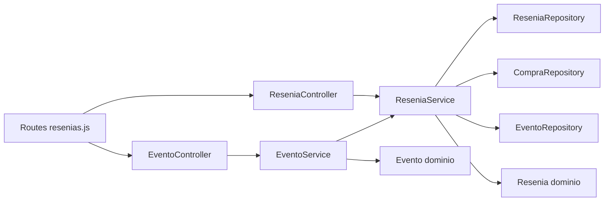

# Requirements

### Overview
Implementar el sistema de reseñas y puntaje del organizador: los compradores pueden puntuar (1-5, pasos de 0.5) y comentar eventos después de usar su entrada; el puntaje del organizador es el promedio de todas las reseñas de todos sus eventos; el catálogo de eventos muestra `puntajeOrganizador` y permite ordenar por puntaje.

### User Stories
- Como comprador, quiero puntuar y comentar un evento después de usar mi entrada, para dejar mi experiencia.
- Como comprador, quiero ver las reseñas de un organizador en los eventos, para conocer experiencias previas antes de comprar.
- Como comprador, quiero ordenar eventos por puntaje del organizador, para encontrar los mejores eventos primero.

### Functional Requirements
- **Resenia.crear**: valida puntaje (1-5, pasos de 0.5), comentario (obligatorio, 1-1000 chars), requiere al menos una compra UTILIZADA del comprador sobre ese evento, una reseña por usuario por evento.
- **Orden de validación**: puntaje/comentario (400) → compra UTILIZADA (403) → reseña previa (409).
- **Puntaje del organizador**: promedio de todas las reseñas de todos sus eventos (cada reseña pesa igual), redondeado a 1 decimal; null si no tiene reseñas.
- **GET /eventos/:id/resenias**: devuelve reseñas de **todos los eventos del organizador** del evento consultado, de más reciente a más antigua.
- **POST /eventos/:id/resenias**: crea una reseña; 201 con la reseña.
- **puntajeOrganizador** en GET /eventos y GET /eventos/:id: calculado y redondeado a 1 decimal.
- **GET /eventos?orden=puntaje**: mejor puntaje primero, null al final, desempate por fecha y nombre.
- **Seed**: organizador A con 2+ eventos y 3+ reseñas (2+ usuarios, medios puntos), organizador B con promedio distinto, organizador sin reseñas.

### Out of Scope
- Editar o borrar reseñas, responder reseñas, reportes.
- Mostrar reseñas en el front (mobile).
- Paginación de reseñas.

# Technical Design

### Current Implementation
- El proyecto sigue arquitectura de capas: `routes → controllers → services → domain → repositories`.
- Controllers son clases con handlers como arrow functions class fields, leen de `req.validado`.
- Services son clases con inyección por constructor.
- Repositorios en memoria (Map), sin interfaz formal pero con métodos consistentes.
- Validación con Zod en `src/schemas/`, middleware `validar()` pone datos en `req.validado`.
- Errores de dominio: `ValidationError`, `ForbiddenError`, `NotFoundError`, `ConflictError`.
- `Evento.sinDetalles()` actualmente devuelve `puntajeOrganizador: null` siempre.
- `EventoService.listarEventos()` tiene `orden === 'puntaje'` que solo aplica desempate (placeholder).
- `CompraRepository` tiene `listarPorComprador` y `listarPorEvento`.
- El seed es determinístico y exporta IDs para tests.
- `crearApp.js` (helper de tests) replica la inyección de `server.js`.

### Key Decisions
- **`Resenia` como clase de dominio con factory `Resenia.crear()`**: sigue el patrón de `Compra.crear()` y `Evento.crear()`. Las validaciones de puntaje, comentario, compra UTILIZADA y reseña previa viven aquí.
- **`ReseniaRepository` en memoria**: sigue el patrón de `CompraRepository` (Map + ID generado).
- **`ReseniaService` orquesta**: busca evento, obtiene compras del usuario, busca reseña previa, llama a `Resenia.crear`, guarda. El service también calcula puntajes de organizadores.
- **`EventoService` inyecta `ReseniaService`**: para obtener `puntajeOrganizador` en las respuestas de evento y para el orden por puntaje.
- **`Evento.sinDetalles(puntajeOrganizador)`**: acepta el puntaje como parámetro para no acoplar `Evento` al repositorio de reseñas.
- **Controllers leen de `req.validado`**: el spec dice `req.datos`, pero el código existente usa `req.validado` consistentemente. Se mantiene el patrón actual.
- **Seed de reseñas en módulo separado**: `seed/resenias.js`, se ejecuta después de `seedCompras`.

### Proposed Changes

**Nuevos archivos:**
- `backend/src/domain/Resenia.js` — clase de dominio con `crear()`, `promedio()`, `paraRespuesta()`.
- `backend/src/repositories/ReseniaRepository.js` — `guardar`, `buscarPorCompradorYEvento`, `listarPorOrganizador`.
- `backend/src/services/ReseniaService.js` — `crear`, `listarDelOrganizadorDe`, `puntajeDelOrganizador`, `puntajesDeOrganizadores`.
- `backend/src/controllers/ReseniaController.js` — `crear` (POST, 201), `listar` (GET).
- `backend/src/routes/resenias.js` — rutas con auth y validación.
- `backend/src/schemas/resenia.schema.js` — schemas Zod.
- `backend/src/seed/resenias.js` — seed de reseñas con compras UTILIZADAS.
- `backend/test/domain/Resenia.test.js` — tests de dominio.
- `backend/test/api/resenias.test.js` — tests de API.

**Archivos modificados:**
- `backend/src/domain/Evento.js` — `sinDetalles()` acepta `puntajeOrganizador` como parámetro.
- `backend/src/services/EventoService.js` — inyectar `reseniaService`, calcular `puntajeOrganizador`, completar `orden === 'puntaje'`.
- `backend/src/controllers/EventoController.js` — pasar `puntajeOrganizador` a `sinDetalles()`.
- `backend/src/routes/eventos.js` — agregar rutas de reseñas (o importarlas de `resenias.js`).
- `backend/src/app.js` — registrar rutas de reseñas.
- `backend/src/server.js` — instanciar `ReseniaRepository`, `ReseniaService`, `ReseniaController`, actualizar inyección.
- `backend/test/helpers/crearApp.js` — mismo que server.js.
- `backend/src/seed/usuarios.js` — agregar usuarios si hace falta.
- `docs/architecture.md` — documentar `Resenia`, schemas, endpoints.
- `docs/testing.md` — corregir descripción de GET /eventos/:id/resenias.

### Data Models / Contracts

**Resenia (clase de dominio)**
```
Resenia.crear({ comprador, evento, puntaje, comentario, compras, reseniaPrevia })
  → Resenia | lanza ValidationError | ForbiddenError | ConflictError

Resenia.promedio(resenias) → number | null

resenia.paraRespuesta() → {
  id, puntaje, comentario, fecha,
  autor: { id, nombre, apellido },
  evento: { id, nombre, fecha }
}
```

**ReseniaRepository**
```
guardar(resenia) → resenia con id
buscarPorCompradorYEvento(compradorId, eventoId) → Resenia | null
listarPorOrganizador(organizadorId) → Resenia[]
```

**ReseniaService**
```
crear(eventoId, usuario, { puntaje, comentario }) → Resenia
listarDelOrganizadorDe(eventoId) → Resenia[]
puntajeDelOrganizador(organizadorId) → number | null
puntajesDeOrganizadores(organizadorIds) → Map<organizadorId, number | null>
```

**Schemas Zod**
```
crearReseniaBodySchema: { puntaje: number (1-5, pasos 0.5), comentario: string (1-1000) }, strict()
eventoIdParamsSchema: { id: string regex }
sinQuerySchema: {} strict
```

### Architecture Diagram



### Risks
- **Acoplamento circular**: `EventoService` depende de `ReseniaService` y `ReseniaService` depende de `EventoRepository`. No hay ciclo porque `ReseniaService` no depende de `EventoService`. Se resuelve inyectando `reseniaService` en `EventoService`.
- **`sinDetalles()` con parámetro**: cambiar la firma de `Evento.sinDetalles()` para aceptar `puntajeOrganizador` es mínimo y no rompe tests existentes si se pasa `null` por defecto.
- **Seed complejo**: el seed de reseñas necesita compras UTILIZADAS que a su vez necesitan eventos y usuarios. Se resuelve ejecutando `seedResenias` después de `seedCompras`.

# Delivery Steps

### ✓ Step 1: Clase Resenia, repositorio y seed
Crear la clase de dominio `Resenia`, el repositorio en memoria y ampliar el seed con reseñas de ejemplo.

- Crear `backend/src/domain/Resenia.js`: clase con `Resenia.crear()` (valida puntaje 1-5 en pasos de 0.5, comentario no vacío ≤1000, compra UTILIZADA obligatoria, una reseña por usuario por evento), `Resenia.promedio()` y `paraRespuesta()`.
- Crear `backend/src/repositories/ReseniaRepository.js`: interfaz con `guardar`, `buscarPorCompradorYEvento`, `listarPorOrganizador`.
- Crear `test/domain/Resenia.test.js`: tests de dominio (puntajes válidos/inválidos, comentario, compra UTILIZADA requerida, segunda reseña ConflictError, promedio).
- Crear `backend/src/seed/resenias.js`: seed determinístico con organizador A (2+ eventos, 3+ reseñas de 2+ usuarios con medios puntos), organizador B con promedio distinto, organizador sin reseñas. Exportar IDs.
- Actualizar `backend/src/seed/usuarios.js`: agregar usuarios adicionales si hace falta para las reseñas.
- Actualizar `backend/src/server.js` y `backend/test/helpers/crearApp.js`: importar e integrar `ReseniaRepository` y `seedResenias`.
- Ejecutar `npm run test:domain` para validar.

### ✓ Step 2: ReseniaService, schema Zod y endpoints
Implementar el servicio, los schemas de validación, el controller y las rutas de reseñas.

- Crear `backend/src/schemas/resenia.schema.js`: `eventoIdParamsSchema`, `crearReseniaBodySchema` (strict, puntaje número 1-5 múltiplo de 0.5 sin coerción, comentario string trim 1-1000), `sinQuerySchema`.
- Crear `backend/src/services/ReseniaService.js`: `crear(eventoId, usuario, {puntaje, comentario})`, `listarDelOrganizadorDe(eventoId)`, `puntajeDelOrganizador(organizadorId)`, `puntajesDeOrganizadores(organizadorIds)`.
- Crear `backend/src/controllers/ReseniaController.js`: `crear` (201), `listar` (GET, reseñas del organizador del evento, ordenadas de más reciente a más antigua).
- Crear `backend/src/routes/resenias.js`: rutas `POST /eventos/:id/resenias` y `GET /eventos/:id/resenias` con auth y validación.
- Integrar en `backend/src/app.js`: registrar las rutas de reseñas.
- Crear `test/api/resenias.test.js`: flujo completo (comprar → pagar → uso → reseñar), 403 sin compra UTILIZADA, 409 segunda reseña, 400 schema, 404 evento inexistente, 401 sin token, GET devuelve reseñas de todos los eventos del organizador, forma de respuesta sin email/contraseña.
- Ejecutar `npm test` para validar.

### ✓ Step 3: Puntaje del organizador en eventos y orden por puntaje
Conectar ReseniaService con EventoService para calcular puntajeOrganizador y completar orden=puntaje.

- Actualizar `backend/src/services/EventoService.js`: inyectar `reseniaService`, calcular `puntajeOrganizador` (redondeado a 1 decimal o null) en `sinDetalles()`, completar `orden === 'puntaje'` (mejor puntaje primero, null al final, desempate fecha ascendente y nombre).
- Actualizar `backend/src/domain/Evento.js`: `sinDetalles()` acepta `puntajeOrganizador` como parámetro.
- Actualizar `backend/src/controllers/EventoController.js`: pasar `puntajeOrganizador` a `sinDetalles()` en `detalleEvento` y `listarEventos`.
- Actualizar `backend/src/server.js` y `backend/test/helpers/crearApp.js`: inyectar `reseniaService` en `EventoService`.
- Ampliar `test/api/resenias.test.js` y `test/api/eventos.test.js`: verificar `puntajeOrganizador` en GET /eventos/:id y GET /eventos, orden por puntaje completo, organizador sin reseñas con null.
- Ejecutar `npm test` para validar.

### ✓ Step 4: Documentación y validación final
Actualizar documentación y ejecutar validación final completa.

- Actualizar `docs/architecture.md`: agregar `Resenia.crear`, `Resenia.promedio`, `resenia.schema.js`, `puntajeOrganizador` calculado, descripción del endpoint GET /eventos/:id/resenias.
- Actualizar `docs/testing.md` sección 4.2: corregir "las reseñas del evento" a "las reseñas del organizador del evento".
- Ejecutar `npm test` completo y mostrar la salida.
- Verificar criterios de aceptación: reglas en dominio, controllers sin try/catch, solo express y zod, sin `new Date()` fuera de reloj.js.