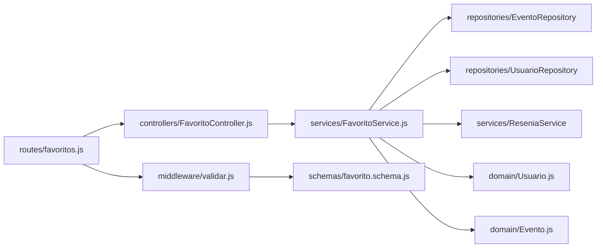

# Requirements

### Overview
Como comprador, quiero poder marcar y desmarcar eventos como favoritos y listar los míos. Los favoritos incluyen eventos futuros y ya realizados, para que un favorito no desaparezca sin que el usuario lo note.

### User Stories
- Como usuario, quiero marcar un evento como favorito para encontrarlo después.
- Como usuario, quiero quitar un evento de mis favoritos.
- Como usuario, quiero ver la lista de mis eventos favoritos ordenados por fecha.

### Functional Requirements
- **Marcar favorito** (`PUT /favoritos/:eventoId`): Idempotente (204). 404 si el evento no existe. 400 por schema inválido.
- **Quitar favorito** (`DELETE /favoritos/:eventoId`): Idempotente (204). 404 si el evento no existe.
- **Listar favoritos** (`GET /favoritos`): 200 con arreglo de eventos (misma forma que `GET /eventos`, incluido `puntajeOrganizador`). Ordenados por fecha ascendente y luego por nombre. Incluye eventos realizados. Solo los del usuario autenticado.
- Todos los endpoints requieren autenticación (401 sin token).
- Un organizador puede marcar como favorito su propio evento.
- La respuesta de `GET /eventos` no incluye `esFavorito`; el front cruza con `GET /favoritos`.

### Non-Functional Requirements
- La lógica de la lista de favoritos vive en `Usuario` (dominio), no en el service ni el controller.
- Params y query se validan con Zod; los controllers leen de `req.validado`.
- No se agregan dependencias: solo `express` y `zod`.
- Los errores se manejan con el middleware central.

### Out of Scope
- Campo `esFavorito` en la respuesta de eventos, contador de favoritos, notificaciones, paginación.
- La pantalla de favoritos (front).

# Technical Design

### Current Implementation
- `Usuario` (`backend/src/domain/Usuario.js`) ya tiene `favoritos` como array de IDs (línea 23), pero sin métodos para manipularlo.
- Los servicios siguen el patrón: clase con inyección por constructor, métodos sincrónicos que lanzan errores de dominio. Ejemplo: `ReseniaService`.
- Los controllers son clases con handlers como arrow functions class field. Leen de `req.validado` y `req.usuario`. Ejemplo: `ReseniaController`.
- Las rutas usan `validar({ params, query, body })` middleware con schemas de Zod. Ejemplo: `resenias.js`.
- El composition root (`server.js`) instancia repositorios → servicios → controllers, y `app.js` registra las rutas.
- `Evento.sinDetalles(puntajeOrganizador)` devuelve el formato de respuesta estándar.

### Proposed Changes

**1. Dominio — `Usuario.js`**
Agregar tres métodos:
- `marcarFavorito(eventoId)`: si `!this.favoritos.includes(eventoId)` → `this.favoritos.push(eventoId)`.
- `desmarcarFavorito(eventoId)`: `this.favoritos = this.favoritos.filter(id => id !== eventoId)`.
- `esFavorito(eventoId)`: `this.favoritos.includes(eventoId)`.

**2. Servicio — `FavoritoService.js` (nuevo)**
Dependencias: `eventoRepository`, `usuarioRepository`, `reseniaService`.
- `marcar(eventoId, usuario)`: busca evento → `NotFoundError` si no existe → `usuario.marcarFavorito(eventoId)` → `usuarioRepository.guardar(usuario)`.
- `quitar(eventoId, usuario)`: busca evento → `NotFoundError` si no existe → `usuario.desmarcarFavorito(eventoId)` → `usuarioRepository.guardar(usuario)`.
- `listar(usuario)`: filtra eventos del repo cuyos IDs están en `usuario.favoritos` → ordena por fecha y nombre → calcula `puntajeOrganizador` → devuelve array de eventos con sus puntajes.

**3. Schema — `favorito.schema.js` (nuevo)**
- `favoritoParamsSchema = z.strictObject({ eventoId: idSchema })` para PUT y DELETE.
- `sinQuerySchema = z.strictObject({})` para las tres rutas.

**4. Controller — `FavoritoController.js` (nuevo)**
- `listar = async (req, res, next)`: llama a `service.listar(req.usuario)`, responde 200 con eventos en formato `sinDetalles(puntaje)`.
- `marcar = async (req, res, next)`: llama a `service.marcar(req.validado.params.eventoId, req.usuario)`, responde 204 sin cuerpo.
- `quitar = async (req, res, next)`: llama a `service.quitar(req.validado.params.eventoId, req.usuario)`, responde 204 sin cuerpo.

**5. Rutas — `favoritos.js` (nuevo)**
- `GET /favoritos` con `authMiddleware`, `validar({ query: sinQuerySchema })`.
- `PUT /favoritos/:eventoId` con `authMiddleware`, `validar({ params: favoritoParamsSchema, query: sinQuerySchema })`.
- `DELETE /favoritos/:eventoId` con `authMiddleware`, `validar({ params: favoritoParamsSchema, query: sinQuerySchema })`.

**6. Wiring**
- `server.js`: instanciar `FavoritoService` y `FavoritoController`, agregarlos a los objetos pasados a `crearApp`.
- `app.js`: importar `crearRutasFavorito`, registrar en `/favoritos`.
- `test/helpers/crearApp.js`: mismo wiring que `server.js`.

**7. Seed**
Después de `seedEventos`, agregar favoritos a `comprador1` usando `marcarFavorito`: por ejemplo `evt_recital1` (futuro), `evt_teatro1` (futuro) y `evt_pasado1` (realizado).

**8. Documentación**
Actualizar `docs/architecture.md`: métodos de `Usuario`, schema, endpoints y códigos 204.

### File Structure
```
backend/
  src/
    domain/Usuario.js              # modificado: 3 métodos nuevos
    services/FavoritoService.js    # nuevo
    controllers/FavoritoController.js  # nuevo
    schemas/favorito.schema.js     # nuevo
    routes/favoritos.js            # nuevo
    app.js                         # modificado: registrar rutas
    server.js                      # modificado: wiring
  test/
    domain/Usuario.test.js         # modificado: tests de favoritos
    api/favoritos.test.js          # nuevo
    helpers/crearApp.js            # modificado: wiring
```

### Architecture Diagram


### Risks
- **Orden de favoritos**: la spec dice "ordenados por fecha ascendente y después por nombre". Esto se hace en el service al listar, no en el array `favoritos` del usuario (que solo guarda IDs en orden de inserción).
- **Eventos eliminados**: si un evento favorito fue eliminado (no existe en el repo), no aparece en el listado. Esto se maneja filtrando en el service.

# Delivery Steps

### ✓ Step 1: Dominio: métodos de favoritos en Usuario
Agregar `marcarFavorito(eventoId)`, `desmarcarFavorito(eventoId)` y `esFavorito(eventoId)` a la clase `Usuario`. Luego ampliar `test/domain/Usuario.test.js` con los casos de prueba.
- `marcarFavorito(eventoId)`: agrega el ID si no existe; llamar dos veces no duplica; mantiene orden de inserción.
- `desmarcarFavorito(eventoId)`: quita el ID si existe; quitar uno que no estaba no falla.
- `esFavorito(eventoId)`: devuelve `true` o `false`.
- Tests: marcar agrega, marcar dos veces no duplica, orden se mantiene, desmarcar quita, desmarcar inexistente no falla, `esFavorito` verdadero y falso.
- Archivo modificado: `backend/src/domain/Usuario.js`, `backend/test/domain/Usuario.test.js`.

### ✓ Step 2: Servicio, schema, controller y rutas de favoritos
Crear `FavoritoService`, `FavoritoController`, schema de zod y rutas de Express.
- `FavoritoService` (`backend/src/services/FavoritoService.js`): `marcar(eventoId, usuario)` busca evento (404 si no existe), llama a `usuario.marcarFavorito` y persiste; `quitar(eventoId, usuario)` igual con `desmarcarFavorito`; `listar(usuario)` devuelve eventos favoritos ordenados por fecha y nombre, incluyendo realizados, sin eventos que ya no existan.
- `favorito.schema.js` (`backend/src/schemas/favorito.schema.js`): `favoritoParamsSchema` con `eventoId: idSchema` (strict), `sinQuerySchema`.
- `FavoritoController` (`backend/src/controllers/FavoritoController.js`): `listar` (GET, 200), `marcar` (PUT, 204), `quitar` (DELETE, 204). Lee de `req.validado` y `req.usuario`.
- `favoritos.js` (`backend/src/routes/favoritos.js`): 3 rutas con `authMiddleware`, `validar` y `asyncHandler`.
- Wirear en `server.js`, `app.js` y `test/helpers/crearApp.js`.

### ✓ Step 3: Seed de favoritos y documentación
Agregar favoritos de ejemplo al usuario comprador1 y actualizar documentación.
- En `seedUsuarios` (o un nuevo `seedFavoritos` llamado desde `server.js` después del seed de eventos), usar `marcarFavorito` para agregar 2-3 favoritos a `comprador1`: uno con fecha futura (ej. `evt_recital1`) y uno ya realizado (`evt_pasado1`).
- Actualizar `docs/architecture.md`: documentar los métodos de `Usuario`, el schema `favorito.schema.js`, los endpoints y los códigos 204.
- Archivos modificados: `backend/src/seed/usuarios.js` (o nuevo archivo de seed), `backend/src/server.js`, `docs/architecture.md`.

### ✓ Step 4: Tests de API de favoritos
Crear `test/api/favoritos.test.js` con todos los casos de la spec.
- Marcar, listar y quitar: el evento aparece y luego desaparece.
- Marcar dos veces no duplica (listado tiene una sola entrada), 204 ambas veces.
- Quitar un evento que no era favorito: 204.
- Listado trae la forma de evento del spec 02 (con `puntajeOrganizador`), ordenado por fecha y nombre.
- Incluye eventos ya realizados.
- Cada usuario ve solo los suyos (dos usuarios con favoritos distintos).
- Favoritos del seed se listan correctamente.
- Evento inexistente: 404 en PUT y DELETE. `:eventoId` inválido: 400. Query en las tres rutas: 400. Sin token: 401.
- Organizador marca su propio evento: 204.
- Ninguna respuesta contiene email, contraseña ni hash.
- Archivo creado: `backend/test/api/favoritos.test.js`.