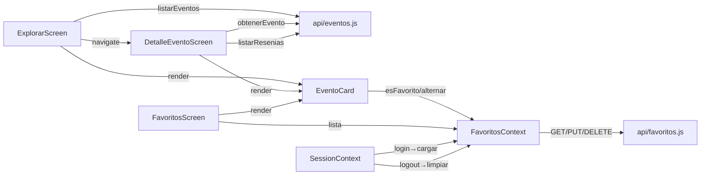

# Requirements

### Step status
### ✓ Step 1: API layers
### ✓ Step 2: Hook useDebounce
### ✓ Step 3: FavoritosContext
### ✓ Step 4: Componente EventoCard
### ✓ Step 5: Pantalla Explorar
### ✓ Step 6: Pantalla Detalle de Evento
### ✓ Step 7: Pestaña Favoritos
### ✓ Step 8: Navegación

### Overview & Goals
Implementar el catálogo de eventos en el mobile: búsqueda por texto y categoría, ordenamiento, detalle de evento con reseñas del organizador, y sistema de favoritos con actualización optimista.

### User Stories
- Como comprador, quiero buscar eventos por texto o explorarlos por categorías.
- Como comprador, quiero ordenar eventos por precio, fecha y puntaje del organizador.
- Como comprador, quiero ver las reseñas del organizador antes de comprar.
- Como usuario, quiero marcar y desmarcar favoritos y ver los míos.

### Scope

**In Scope:**
1. API layers: `src/api/eventos.js` y `src/api/favoritos.js`.
2. Hook `useDebounce` (400 ms, sin librerías).
3. Context `FavoritosContext` (carga al iniciar sesión, optimista, rollback).
4. Pantalla Explorar: búsqueda, categorías (chips), orden, FlatList con `EventoCard`, estados (cargando, error, vacío, pull-to-refresh).
5. Pantalla Detalle de evento: imágenes (carrusel), info, tipos de entrada, reseñas del organizador, aviso de evento realizado.
6. Pestaña Favoritos: lista de favoritos, quitar favorito, estado vacío, etiqueta de evento realizado.
7. Navegación stack: Detalle sobre las pestañas.

**Out of Scope:**
- Comprar entradas (spec 08c).
- Ver compras de un evento como organizador (spec 08d).
- Paginación, mapa, compartir evento.

### Acceptance Criteria (from spec)
- `npx expo-doctor` sin errores nuevos.
- Búsqueda por texto y categoría filtra; sin resultados muestra estado vacío.
- Ordenar por precio, fecha y puntaje cambia el orden (lo devuelve la API).
- Detalle muestra reseñas del organizador.
- Marcar, ver en Favoritos y quitar un favorito.
- Cambiar rápido de filtro no deja un resultado viejo en pantalla.
- Falla de API al marcar favorito revierte el corazón y muestra el error.
- El front no reordena ni filtra la lista de la API.
- Ninguna pantalla llama a `fetch`; todo pasa por `src/api/`.
- Sin dependencias nuevas fuera de las aprobadas en 08a.


# Technical Design

### Current Implementation
- **Mobile base (spec 07)** ya implementado: navegación con 5 tabs (Explorar, Favoritos, Compras, Mis eventos, Cuenta), sesión (`SessionContext`), cliente HTTP (`api/client.js`), componentes base (`Pantalla`, `Boton`, `CampoTexto`, `Cargando`, `ErrorMensaje`, `EstadoVacio`), utilidades (`formato.js`), tema (`theme.js`).
- **ExplorarScreen** y **FavoritosScreen** son plantillas vacías ("Próximamente").
- **Backend** completo: `GET /eventos?q=&categoria=&orden=`, `GET /eventos/:id`, `GET /categorias`, `GET /eventos/:id/resenias`, `GET /favoritos`, `PUT /favoritos/:eventoId` (204), `DELETE /favoritos/:eventoId` (204).
- **Contratos de respuesta** conocidos desde specs 02, 05, 06.

### Key Decisions
1. **`useDebounce` propio** (sin librerías): hook con `useState` + `useEffect` + `setTimeout` de 400 ms. Cumple con la regla de sin librerías nuevas.
2. **Request ID para evitar respuestas viejas**: cada consulta al catálogo incrementa un `requestId` (via `useRef`). Si la respuesta llega con un `requestId` menor al actual, se descarta. Simple y sin librerías.
3. **FavoritosContext separado de SessionContext**: mantiene el conjunto de IDs de favoritos, carga `GET /favoritos` al iniciar sesión, expone `esFavorito(id)`, `alternar(evento)`, y la lista. Se vacía al cerrar sesión. El `SessionContext` se extiende para cargar los favoritos tras el login y vaciarlos en logout.
4. **Actualización optimista con rollback**: al tocar el corazón, el estado cambia de inmediato y se envía la petición. Si falla, se revierte y se muestra el `message` del error.
5. **EventoCard como componente compartido**: usado tanto en Explorar como en Favoritos. Recibe el evento y el contexto de favoritos.
6. **Detalle como stack screen**: se agrega al `AppNavigator` como ruta stack sobre `TabNavigator`. Se navega con `navigation.navigate('Detalle', { eventoId })`.

### Proposed Changes

#### 1. API Layers
- **`src/api/eventos.js`**: `listarEventos({ q, categoria, orden }, token)`, `obtenerEvento(id, token)`, `listarCategorias(token)`, `listarResenias(eventoId, token)`.
- **`src/api/favoritos.js`**: `listarFavoritos(token)`, `marcarFavorito(eventoId, token)`, `quitarFavorito(eventoId, token)`.

#### 2. Hook `useDebounce`
- **`src/hooks/useDebounce.js`**: exporta `useDebounce(value, delay)` → valor debounceado. 400 ms por defecto.

#### 3. FavoritosContext
- **`src/context/FavoritosContext.js`**: `FavoritosProvider` y `useFavoritos()`.
  - Estado: `favoritos` (array de eventos), `loading`, `error`.
  - `cargarFavoritos(token)`: llama `GET /favoritos`, guarda IDs y lista.
  - `esFavorito(id)`: verifica si el ID está en el conjunto.
  - `alternar(evento)`: optimista (agrega/quita de inmediato), llama `PUT` o `DELETE`. Si falla, revierte y guarda el error.
  - `quitarDeLista(eventoId)`: para la pestaña Favoritos, quita de la lista sin llamar API (la llamada la hace `alternar`).
  - Se vacía en `limpiar()` (logout).
- **`SessionContext.js`**: se integra con `FavoritosProvider` — tras login exitoso llama `cargarFavoritos(token)`, en logout llama `limpiar()`.

#### 4. Componente `EventoCard`
- **`src/components/EventoCard.js`**: tarjeta con nombre, categoría, fecha y hora, "Desde $ X" (`precioDesde`), puntaje del organizador (`★ 4.3` o "Sin reseñas"), nombre del organizador y botón de favorito (corazón). Recibe `evento`, `onPress`, y usa `useFavoritos()` para el botón.

#### 5. Pantalla Explorar
- **`src/screens/ExplorarScreen.js`**:
  - `CampoTexto` de búsqueda → `useDebounce(400 ms)` → `q`.
  - Chips horizontales de categorías ("Todas" + `GET /categorias`).
  - Selector de orden: Fecha (default), Precio, Puntaje.
  - `FlatList` con `EventoCard`.
  - Estados: `Cargando`, `ErrorMensaje` con "Reintentar", `EstadoVacio` ("No encontramos eventos con esa búsqueda").
  - Pull-to-refresh (`RefreshControl`).
  - `requestId` para descartar respuestas viejas.
  - Cada cambio de filtro dispara `listarEventos()`.

#### 6. Pantalla Detalle de Evento
- **`src/screens/DetalleEventoScreen.js`**:
  - Carrusel de imágenes (`ScrollView` horizontal con `Image`). Si la lista está vacía o una imagen falla, recuadro neutro.
  - Nombre, categoría, descripción, fecha y hora, organizador con puntaje.
  - Lista de tipos de entrada: nombre, descripción, precio, disponibilidad ("Quedan N" o "Agotado").
  - Sección Reseñas del organizador (`GET /eventos/:id/resenias`): puntaje, comentario, autor, evento, fecha. Sin reseñas: "Este organizador todavía no tiene reseñas." Error propio con "Reintentar".
  - Aviso "Este evento ya se realizó" si `yaSeRealizo()` (comparar fecha con `new Date()`).
  - Botón de favorito.

#### 7. Pestaña Favoritos
- **`src/screens/FavoritosScreen.js`**:
  - Lista de favoritos (mismo `EventoCard`).
  - Los eventos realizados muestran etiqueta "Ya se realizó".
  - Estado vacío: "Todavía no marcaste favoritos."
  - Quitar favorito desde aquí lo saca de la lista.

#### 8. Navegación
- **`src/navigation/AppNavigator.js`**: agregar `DetalleEventoScreen` como stack screen sobre `TabNavigator`.

### File Structure
```
mobile/src/
  api/
    eventos.js          # NEW
    favoritos.js        # NEW
  components/
    EventoCard.js       # NEW
  context/
    FavoritosContext.js # NEW
  hooks/
    useDebounce.js      # NEW
  screens/
    ExplorarScreen.js   # MODIFIED (was placeholder)
    DetalleEventoScreen.js # NEW
    FavoritosScreen.js  # MODIFIED (was placeholder)
  navigation/
    AppNavigator.js     # MODIFIED (add Detalle stack screen)
  context/
    SessionContext.js   # MODIFIED (integrate with FavoritosContext)
```

### Architecture Diagram


### Risks
- **`FlatList` con `RefreshControl`**: nativo de React Native, no requiere dependencias nuevas.
- **Carrusel de imágenes**: usar `ScrollView` horizontal simple con `Image`. Sin librerías de carrusel.
- **Sincronización FavoritosContext con SessionContext**: el `FavoritosProvider` debe envolver al `AppNavigator` y el `SessionContext` debe llamar a `cargarFavoritos` tras login. Se logra con un ref al contexto de favoritos o pasando callbacks.
