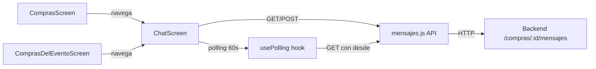

# Requirements

### Overview
Implementar el chat de la compra en el mobile: una pantalla donde comprador y organizador pueden intercambiar mensajes mediante polling REST cada 60 segundos, sin WebSockets ni SSE.

### Scope

**In Scope:**
- Funciones de API en `src/api/mensajes.js` para listar y enviar mensajes.
- Hook `src/hooks/usePolling.js` para polling configurable con control de foco.
- Pantalla `ChatScreen` con lista de mensajes, envío, y manejo de estados.
- Registro de la pantalla en `AppNavigator.js`.
- Botón "Mensajes" en `ComprasScreen` (comprador) y `ComprasDelEventoScreen` (organizador).

**Out of Scope:**
- Notificaciones, indicador de mensajes no leídos, adjuntos, edición o borrado.
- Backend (ya implementado en spec 04).

### User Stories
- Como comprador, quiero enviar mensajes sobre una compra desde cualquier estado (incluida CANCELADA o REEMBOLSADA).
- Como organizador, quiero responder mensajes de compradores sobre mis eventos.
- Como usuario, quiero que los mensajes nuevos aparezcan dentro de los 60 segundos sin recargar manualmente.

### Acceptance Criteria (clave)
- `npx expo-doctor` sin errores nuevos.
- Fila 14: mensaje enviado aparece de inmediato en el emisor y en el otro dentro de 60 s.
- Fila 15: al salir del chat, el polling se detiene (log de desarrollo + backend deja de recibir consultas).
- Se puede enviar en compra CANCELADA o REEMBOLSADA.
- Envío fallido conserva el texto.
- Doble toque en "Enviar" no duplica.
- El polling no se acumula al abrir y cerrar varias veces.
- Sin WebSockets, SSE ni long polling.
- Sin dependencias nuevas.

# Technical Design

### Current Implementation
- **API client** (`src/api/client.js`): función `request(method, path, {query, body, token})` con timeout de 15s, manejo de errores uniforme (`ApiError` con `status`, `code`, `message`), y `buildQuery` que filtra valores nulos/vacíos.
- **API modules** (`src/api/compras.js`, `src/api/eventos.js`): funciones puras que llaman a `request` con el método y path correspondiente. Sin estado.
- **Hooks** (`src/hooks/useDebounce.js`): hook personalizado simple con `useState` + `useEffect`.
- **Screens** (`ComprasScreen.js`, `ComprasDelEventoScreen.js`): patrón consistente — `useFocusEffect` para recargar al enfocar, `RefreshControl` para pull-to-refresh, componentes `Cargando`, `ErrorMensaje`, `EstadoVacio` para los estados.
- **Navigation** (`AppNavigator.js`): `createNativeStackNavigator` con pantallas registradas como `Stack.Screen` con `headerShown: true` y estilos del tema.
- **Session** (`SessionContext.js`): provee `token` y `usuario` (con `id`, `nombre`, `apellido`).
- **Backend API** (spec 04): `GET /compras/:id/mensajes?desde=` devuelve `[{id, autor: {id, nombre, apellido}, texto, fechaHora}]`, `POST /compras/:id/mensajes` con body `{texto}`. 403 si no es comprador ni organizador, 404 si no existe.
- **Theme** (`theme.js`): colores, espaciados, texto, botones.

### Key Decisions
- **`usePolling` con ref para la función**: usa `useRef` para guardar la función más reciente sin reiniciar el intervalo en cada render. Un flag `isRunning` evita consultas concurrentes.
- **`useFocusEffect` para controlar polling**: el hook `activo` se vincula al foco de la pantalla vía `useFocusEffect` de React Navigation.
- **Deduplicación por `id`**: al agregar mensajes del polling, se filtran los que ya existen en la lista comparando por `id`.
- **`KeyboardAvoidingView`**: el componente `Pantalla` no lo incluye, por lo que la `ChatScreen` lo agrega para que el teclado no tape el campo de envío.
- **Botón "Mensajes" como `TouchableOpacity` pequeño**: se agrega a `CompraCard` en ambas pantallas existentes, navegando al chat con `compraId`, `titulo` (nombre del evento), y opcionalmente `nombreComprador`.

### Proposed Changes

#### 1. `src/api/mensajes.js` (nuevo)
- `listarMensajes(compraId, { desde }, token)`: GET a `/compras/${compraId}/mensajes`. Si `desde` existe, se pasa como query param `desde` con el valor ISO 8601 tal como lo devolvió el servidor. 
- `enviarMensaje(compraId, texto, token)`: POST a `/compras/${compraId}/mensajes` con body `{ texto }`.

#### 2. `src/hooks/usePolling.js` (nuevo)
- Firma: `usePolling(fn, intervaloMs, { activo })`.
- `useRef` para `fn` (siempre la versión más reciente).
- `useRef` boolean `isRunning` para evitar consultas concurrentes.
- `useEffect` que crea `setInterval` cuando `activo` es true, lo limpia cuando es false o al desmontar.
- Dentro del intervalo: verifica `!isRunning.current`, lo marca, ejecuta `fnRef.current()`, y lo desmarca en `.finally()`.
- Logs en `__DEV__`: cuándo arranca, ejecuta y se detiene.

#### 3. `src/screens/ChatScreen.js` (nuevo)
- Props: `{ route, navigation }` donde `route.params = { compraId, titulo, nombreComprador? }`.
- Estado: `mensajes` (array), `loading` (primera carga), `error`, `texto` (input), `enviando` (bool), `ultimoFechaHora` (para `desde`).
- `useFocusEffect` para cargar al abrir y controlar `activo` del polling.
- `usePolling` con 60000ms que consulta con `desde` = `ultimoFechaHora` y agrega sin duplicar.
- `FlatList` con `FlatListRef` para `scrollToEnd()` después de cargar y después de enviar.
- Mensajes propios (`autor.id === usuario.id`) a la derecha (alineados con `alignItems: 'flex-end'`), los otros a la izquierda.
- Cada burbuja muestra `autor.nombre` y `formatearFechaHora(mensaje.fechaHora)`.
- Input multilínea (`numberOfLines={1}`, `multiline={true}`), máximo 1000 caracteres, contador visible.
- Botón "Enviar" deshabilitado si `texto.trim() === ''` o `enviando`.
- Después de POST exitoso: limpiar input, refrescar con `desde`, scroll al final.
- Si POST falla: conservar texto, mostrar `error.message`.
- 403/404 en carga inicial: mostrar mensaje y `navigation.goBack()`.
- Polling fallido: aviso discreto "No se pudo actualizar", sin borrar mensajes.
- `KeyboardAvoidingView` con `behavior: 'padding'`.
- Estados: cargando (primera vez), error con "Reintentar", vacío.

#### 4. `src/navigation/AppNavigator.js` (modificado)
- Importar `ChatScreen`.
- Agregar `Stack.Screen` con nombre `Chat`, `headerTitle` dinámico desde props, mismo estilo de header que las demás pantallas.

#### 5. `src/screens/ComprasScreen.js` (modificado)
- En `CompraCard`: agregar botón "Mensajes" (Ionicons `chatbubble-outline`) que navega a `Chat` con `{ compraId: compra.id, titulo: compra.evento?.nombre }`.
- Disponible en cualquier estado de la compra.

#### 6. `src/screens/ComprasDelEventoScreen.js` (modificado)
- En `CompraCard`: agregar botón "Mensajes" que navega a `Chat` con `{ compraId: compra.id, titulo: `${evento?.nombre} — ${compra.comprador?.nombre} ${compra.comprador?.apellido || ''}` }`.
- Disponible en cualquier estado.

### File Structure
```
mobile/src/
  api/
    mensajes.js              # NUEVO
  hooks/
    usePolling.js            # NUEVO
  screens/
    ChatScreen.js            # NUEVO
  navigation/
    AppNavigator.js          # MODIFICADO (agregar Chat screen)
  screens/
    ComprasScreen.js         # MODIFICADO (botón Mensajes en CompraCard)
    ComprasDelEventoScreen.js # MODIFICADO (botón Mensajes en CompraCard)
```

### Architecture Diagram


### Risks
- **KeyboardAvoidingView en Expo**: el behavior puede variar entre iOS y Android. Se usará `behavior: 'padding'` y se probará en ambos.
- **FlatList scrollToEnd**: puede no funcionar si se llama antes de que la lista termine de renderizar. Se usará `setTimeout` breve o `onLayout` del FlatList.
- **Polling race condition**: si el usuario envía y el polling se ejecutan al mismo tiempo, la deduplicación por `id` evita mensajes duplicados.

# Delivery Steps

### * Step 1: Crear funciones de API y hook de polling
Se crean `src/api/mensajes.js` y `src/hooks/usePolling.js` — los cimientos del chat.
- `mensajes.js`: `listarMensajes(compraId, { desde }, token)` hace GET a `/compras/${compraId}/mensajes` pasando `desde` como ISO 8601 si existe; `enviarMensaje(compraId, texto, token)` hace POST con `{ texto }`.
- `usePolling.js`: hook con `useRef` para la función y un flag `isRunning` para evitar consultas concurrentes. `useEffect` crea/limpia `setInterval` según `activo`. Logs en `__DEV__`. No reinicia el intervalo cuando la función cambia.
- Validar que no se introducen dependencias nuevas.

###   Step 2: Implementar ChatScreen con UI de mensajes y envío
Se crea `src/screens/ChatScreen.js` — la pantalla completa del chat.
- Estado: `mensajes`, `loading`, `error`, `texto`, `enviando`, `ultimoFechaHora`.
- `useFocusEffect` carga los mensajes al abrir y controla `activo` del polling.
- `usePolling` cada 60s consulta con `desde` y agrega sin duplicar por `id`.
- `FlatList` con burbujas: propios a la derecha, del otro a la izquierda, con nombre y hora.
- Input multilínea (máx 1000 caracteres, contador), botón Enviar deshabilitado si vacío o enviando.
- POST exitoso: limpiar input, refrescar con `desde`, scroll al final. POST fallido: conservar texto, mostrar error.
- 403/404: mensaje y volver atrás. Polling fallido: aviso discreto sin borrar mensajes.
- Estados: cargando, error con "Reintentar", vacío.
- `KeyboardAvoidingView` para que el teclado no tape el input.
- Scroll al final al cargar y al agregar mensajes.

###   Step 3: Registrar Chat en navegación y agregar botones de entrada
Se conecta el chat a la app: navegación y puntos de entrada desde las pantallas existentes.
- `AppNavigator.js`: importar `ChatScreen`, agregar `Stack.Screen` con nombre `Chat`, header dinámico con el título pasado por params.
- `ComprasScreen.js` (`CompraCard`): agregar botón "Mensajes" (icono `chatbubble-outline` de Ionicons) que navega a `Chat` con `{ compraId, titulo: evento.nombre }`. Disponible en cualquier estado.
- `ComprasDelEventoScreen.js` (`CompraCard`): agregar botón "Mensajes" que navega a `Chat` con `{ compraId, titulo: `${evento.nombre} — ${comprador.nombre} ${comprador.apellido}` }`. Disponible en cualquier estado.
- Verificar que `npx expo-doctor` no reporte errores nuevos.