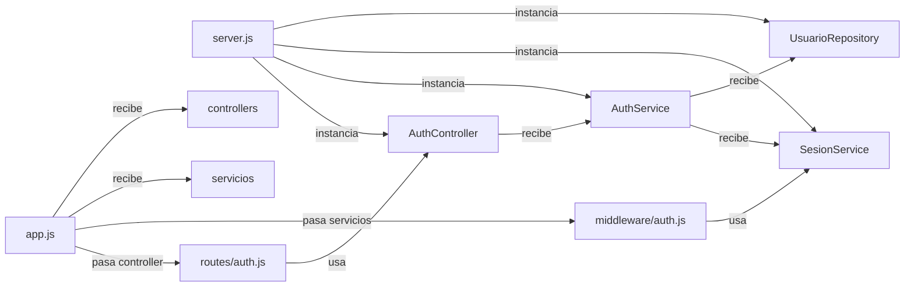

# Requirements

### ✓ Step 1: Crear AuthService y AuthController como clases

Refactorizar el módulo de autenticación para que controllers y services sean clases, según la sección "Clases e inyección de dependencias" de `docs/architecture.md`. No debe cambiar el comportamiento observable: rutas, status codes, formato de respuestas y mensajes de error son los mismos.

### Scope

**In Scope:**
- Crear `services/AuthService.js` (clase) que centralice la lógica de login.
- Reemplazar `controllers/authController.js` por `controllers/AuthController.js` (clase) con handlers como arrow functions class fields.
- `routes/auth.js`: `crearRutasAuth` recibe el controller ya instanciado.
- `server.js`: instanciar en orden repositorios → services → controllers.
- `app.js`: recibir controllers y servicios, pasar servicios al middleware auth.
- `middleware/auth.js`: recibir `servicios` en lugar de `repositorios` para acceder a `sesionService`.
- `test/helpers/crearApp.js`: ajustar al nuevo cableado.
- `sesionService` ya no se pasa en `repositorios`, solo en `servicios`.

**Out of Scope:**
- Schemas, validar, errorHandler.
- Reglas de dominio.
- `SesionService.js` (ya es clase, no se toca).
- Nombres de propiedades (`req.validado` se mantiene).

### Acceptance Criteria

- `pnpm test` completo pasa (todos los tests existentes).
- Rutas, status codes, formato de respuestas y mensajes de error son idénticos.
- Controllers y services son clases con inyección por constructor.
- Handlers son arrow functions class fields.
- `server.js` instancia en orden: repositorios → services → controllers.
- `sesionService` solo vive en `servicios`, no en `repositorios`.
- Ningún controller tiene try/catch.
- No se agregaron dependencias.

# Technical Design

### Current Implementation

**Cableado actual:**
- `server.js` instancia `usuarioRepository`, `sesionService` y pasa ambos en `repositorios` y `servicios` (duplicado).
- `app.js` (`crearApp`) recibe `{ repositorios, servicios }` y los pasa a `crearRutasAuth`.
- `routes/auth.js` (`crearRutasAuth`) recibe `(repositorios, servicios)` y los pasa a `login()` y `yo()` del controller.
- `controllers/authController.js` exporta funciones factory `login(repositorios, servicios)` y `yo(repositorios, servicios)`.
- `middleware/auth.js` recibe `repositorios` y accede a `repositorios.sesionService`.
- `test/helpers/crearApp.js` duplica `sesionService` en ambos objetos.

**Problema:** El controller es un módulo de funciones factory, no una clase. El `sesionService` está duplicado en `repositorios` y `servicios`.

### Key Decisions

- **`sesionService` solo en `servicios`:** Se elimina de `repositorios`. El middleware auth ahora recibe `servicios` en lugar de `repositorios`.
- **`AuthService` como clase:** Centraliza login: busca usuario, verifica password, crea token, devuelve `{ token, usuario }` sin password.
- **`AuthController` como clase:** Handlers como arrow functions class fields. Constructor recibe `{ authService }`.
- **`crearRutasAuth` recibe controller instanciado:** Ya no necesita repositorios ni servicios.
- **`app.js` recibe controllers:** Nuevo parámetro `controllers` en `crearApp`.

### Proposed Changes

**1. `src/services/AuthService.js` (nuevo)**
- Clase. Constructor: `{ usuarioRepository, sesionService }`.
- `login(email, password)`: busca usuario por email, verifica password, crea token, devuelve `{ token, usuario }` donde `usuario` es `usuario.sinPassword()`.
- Si las credenciales son incorrectas lanza `UnauthorizedError('Email o contraseña incorrectos.')` — mismo mensaje para email inexistente y password incorrecta.

**2. `src/controllers/AuthController.js` (nuevo, reemplaza authController.js)**
- Clase. Constructor: `{ authService }`.
- `login = async (req, res, next) => {}`: lee `req.validado.body`, llama a `authService.login`, responde `res.json({ token, usuario })`.
- `yo = (req, res, _next) => {}`: responde `req.usuario.sinPassword()`.
- Sin reglas de negocio ni try/catch.

**3. `src/routes/auth.js` (modificado)**
- `crearRutasAuth(authController)` recibe el controller ya instanciado.
- Usa `asyncHandler(authController.login)` y `authController.yo`.
- Ya no recibe `repositorios` ni `servicios`.

**4. `src/middleware/auth.js` (modificado)**
- Cambia `auth(repositorios)` a `auth(servicios)`.
- Accede a `servicios.sesionService` en lugar de `repositorios.sesionService`.

**5. `src/app.js` (modificado)**
- `crearApp({ repositorios, servicios, controllers })` recibe controllers.
- Pasa `servicios` al middleware auth (en lugar de `repositorios`).
- Pasa `controllers.authController` a `crearRutasAuth`.

**6. `src/server.js` (modificado)**
- Instanciar en orden:
  1. Repositorios: `new UsuarioRepository()` + seed.
  2. Services: `new SesionService()`, `new AuthService({ usuarioRepository, sesionService })`.
  3. Controllers: `new AuthController({ authService })`.
- Pasar a `crearApp`: `{ repositorios: { usuarioRepository }, servicios: { sesionService, authService }, controllers: { authController } }`.
- `sesionService` ya no en `repositorios`.

**7. `test/helpers/crearApp.js` (modificado)**
- Instanciar AuthService y AuthController como en server.js.
- Pasar controllers a `crearApp`.
- `sesionService` solo en `servicios`.

**8. Eliminar `src/controllers/authController.js`

### Architecture Diagram

### Risks

- **Middleware auth cambia su parámetro:** De `repositorios` a `servicios`. Esto es un cambio de firma que afecta a `app.js` y `crearApp.js` (test). Se actualizan todos juntos.
- **Tests existentes:** Los tests de `auth.test.js` no instancian controllers directamente — usan `crearApp` — por lo que solo necesitan que `crearApp` funcione igual.

### ✓ Step 2: Actualizar cableado y ejecutar tests

# Testing

### Validation Approach

Ejecutar `pnpm test` en `backend/` y verificar que todos los tests pasan.

### Key Scenarios

- Login correcto devuelve token y usuario.
- Login incorrecto (email/password) devuelve 401.
- `GET /auth/yo` con token válido devuelve usuario.
- `GET /auth/yo` sin token devuelve 401.
- Validación de schemas (strict, campos faltantes, etc.).
- Errores de dominio (404, 400 JSON inválido, 500).
- Usuario: hash, verificar, sinPassword.

### Edge Cases

- Dos logins del mismo usuario devuelven tokens distintos.
- Token inventado responde 401.
- Clave extra en body responde 400.

